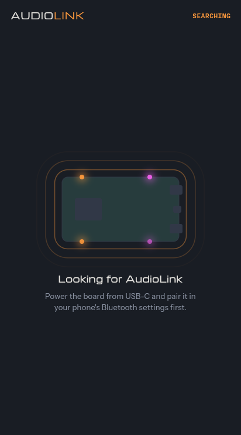
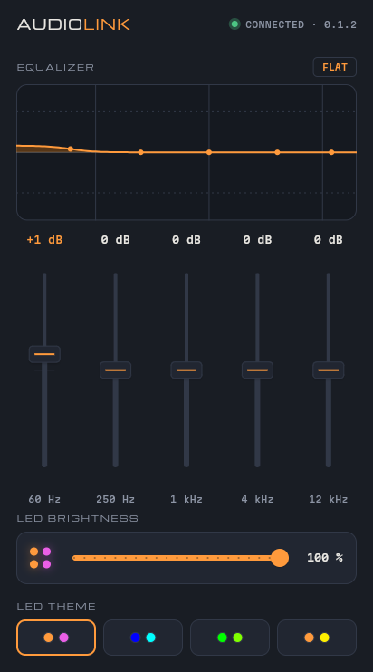
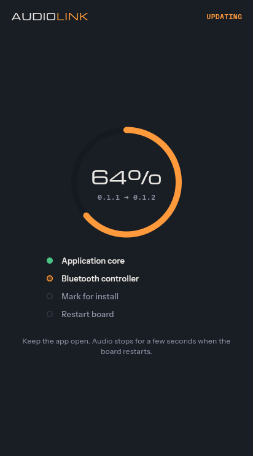
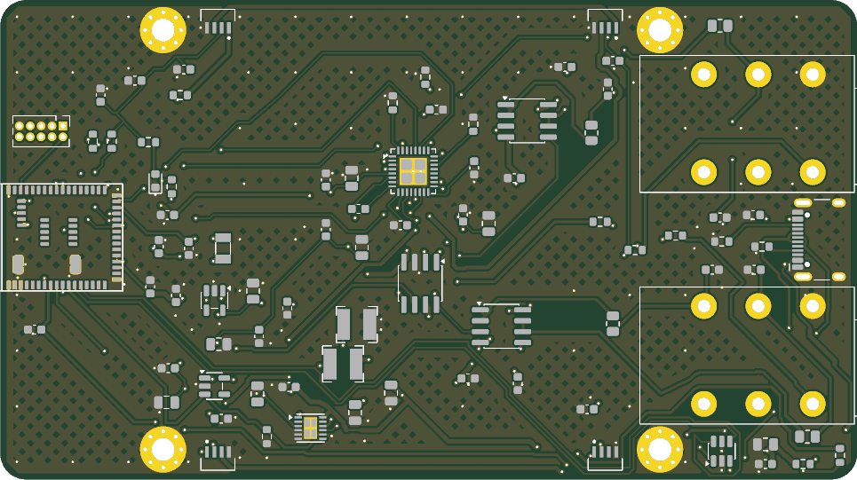

# AudioLink

AudioLink is a USB and Bluetooth LE Audio receiver with line outputs. Connect it to an amplifier
or active speakers and play music from a computer, a phone or an Auracast broadcast.

## Features

- **Three sources:** a computer over USB, a phone over Bluetooth LE Audio, or an Auracast
  broadcast.
- **Two 6.35 mm line outputs:** unbalanced stereo or balanced.
- **5-band equalizer**, set from the companion app.
- **Four LEDs that follow the music:** they jump up on loud sounds and fade out in quiet parts.
- **Firmware updates** from the app, over USB or over SWD.
- **Powered from USB-C.** No driver is needed on the computer.

## Hardware

| Part          | Component                                     |
| ------------- | --------------------------------------------- |
| Module        | MinewSemi MS45SF1 (nRF5340, Bluetooth LE)     |
| DAC           | TI PCM5242                                    |
| Output buffer | TI OPA1678                                    |
| LEDs          | 4 x WS2812                                    |
| Outputs       | 2 x 6.35 mm jack (J1, J2)                     |
| Power         | USB-C (J3)                                    |
| PCB           | 4 layers, 100 x 56 mm, all parts on the top   |

## Repository layout

| Path        | Contents                                                             |
| ----------- | -------------------------------------------------------------------- |
| `firmware/` | Zephyr / nRF Connect SDK firmware for both nRF5340 cores             |
| `app/`      | Flutter app (Android, Linux): equalizer, LEDs, firmware update       |
| `pcb/`      | KiCad schematic and PCB, BOM export script, fabrication files        |
| `assets/`   | Release files: firmware hex and DFU images, Android APK; images      |

## Release files

Current release: **0.1.2**.

| File                                                                | Use                                                     |
| ------------------------------------------------------------------- | ------------------------------------------------------- |
| [AudioLink-0.1.2.apk](assets/AudioLink-0.1.2.apk)                   | Android app                                             |
| [AudioLink-0.1.2-dfu.zip](assets/AudioLink-0.1.2-dfu.zip)           | Firmware update over Bluetooth or USB                   |
| [AudioLink-0.1.2-app-core.hex](assets/AudioLink-0.1.2-app-core.hex) | New board over SWD, application core (MCUboot and app)  |
| [AudioLink-0.1.2-net-core.hex](assets/AudioLink-0.1.2-net-core.hex) | New board over SWD, network core (bootloader and radio) |

The version is set in `firmware/VERSION`. The commands below write it as `<ver>`.

## Quick start

1. Plug a USB-C cable into the board.
2. Connect the outputs:
   - **Stereo cable:** use J1 only.
   - **Balanced:** J1 for left, J2 for right. Plugging anything into J2 switches the board to
     balanced mode.
3. Play some music:
   - **From a computer:** select the "AudioLink" sound card.
   - **From a phone:** pair "AudioLink" in the Bluetooth settings. The phone must support LE
     Audio (classic Bluetooth A2DP and iPhones are not supported).
4. Install the [Android app](assets/AudioLink-0.1.2.apk) to set the equalizer and the LEDs.

Without a connected phone, the board joins the first Auracast broadcast it finds.

When several sources play at once, the board picks one:

> USB > phone > Auracast broadcast

## App

The app connects to the board over Bluetooth LE. It sets the equalizer, the LED brightness and
the LED theme, and installs the firmware bundled in the app.

<p>
  
  
  
</p>

## LEDs

The four LEDs change with the dynamics of the music. They light up at once on a louder sound,
fade over about a second and go dark when the music stops. The level is measured before the
volume, so turning the volume down does not dim them.

In the app you can set:

- **Brightness:** the maximum brightness, from 0% (off) to 100%.
- **Theme:** one of four color pairs.

The small blue LED D5 is the power indicator.

See [LEDs](firmware/README.md#leds) in the firmware README for the LED positions and the
Bluetooth characteristics.

## Flashing and updating

### New board

A new board is flashed over SWD (J-Link on the 10-pin header J4), network core first:

```
nrfutil device recover
nrfutil device program --firmware assets/AudioLink-<ver>-net-core.hex --core Network \
    --options chip_erase_mode=ERASE_ALL
nrfutil device program --firmware assets/AudioLink-<ver>-app-core.hex --core Application \
    --options chip_erase_mode=ERASE_ALL
nrfutil device reset
```

### Board with AudioLink firmware

No probe is needed. Use one of:

- **App:** the update button in the app bar (firmware bundled in the app).
- **nRF Connect Device Manager:** upload `AudioLink-<ver>-dfu.zip` from a paired phone.
- **USB:** `uv run --script firmware/scripts/usb_update.py assets/AudioLink-<ver>-dfu.zip`

The bootloader refuses firmware older than the one running.

## Building

### Firmware

Requirements:

- `nrfutil` with the nRF Connect SDK installed by `nrfutil sdk-manager`
- `just`
- `uv`, for the USB update script

Copy `firmware/.env.example` to `firmware/.env` (not in git) and set the SDK version:

```
NCS_VERSION=v<x.y.z>
# Optional, $HOME/ncs/$NCS_VERSION by default
NCS_DIR=$HOME/ncs/$NCS_VERSION
```

Then, in `firmware/`:

```
just keys    # once, creates the signing keys
just build
```

See [firmware/README.md](firmware/README.md) for all commands, the output modes, LEDs, the
Bluetooth settings service and the update process.

> [!WARNING]
> The signing keys in `firmware/keys/` are not in git. Keep a backup: without them, boards in the
> field can only be updated over SWD.

### App

Bundle the current firmware into the app, then build it with Flutter:

```
cd firmware && just app-firmware
cd ../app && flutter build apk
```

### Release files

| Copy from                                           | To                               |
| --------------------------------------------------- | -------------------------------- |
| `firmware/build/app/dfu_application.zip`            | `assets/AudioLink-<ver>-dfu.zip` |
| `app/build/app/outputs/flutter-apk/app-release.apk` | `assets/AudioLink-<ver>.apk`     |

The hex files are merged from the build output, see
[Release files](firmware/README.md#release-files) in the firmware README. Then update the links
in [Release files](#release-files) above to the new version.

## PCB



The KiCad project is `pcb/AudioLink.kicad_pro`. A PDF of the schematic is in
`pcb/fab/AudioLink-schematic.pdf`.

- `pcb/fab/` has the fabrication and assembly files, with notes on part substitutions in
  `pcb/fab/README-fab.txt`.
- `pcb/export_bom.py` regenerates `pcb/fab/AudioLink-BOM.csv` from the schematic.

### Enclosure

The board fits the CamdenBoss
[CBHEX1-06-WH](https://www.camdenboss.com/camden-boss/cbhex1-06-wh-hex-box-iot-enclosure-with-6-vented-panels,-white/c-23/p-24194)
Hex-Box enclosure:

- ABS, 146 x 130 x 45 mm outside, 122.5 x 125.5 x 34.5 mm inside
- six removable vented side panels

The jacks J1 and J2 overhang the board edge so they reach a side panel.

## License

| Part                      | License                                                                                              |
| ------------------------- | ---------------------------------------------------------------------------------------------------- |
| Firmware, app and scripts | MIT, see [LICENSE](LICENSE)                                                                          |
| PCB design in `pcb/`      | CERN Open Hardware Licence v2 - Strongly Reciprocal (CERN-OHL-S-2.0), see [pcb/LICENSE](pcb/LICENSE) |
